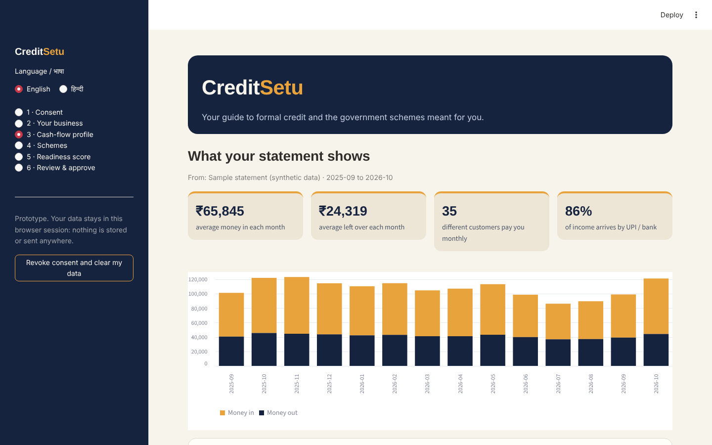
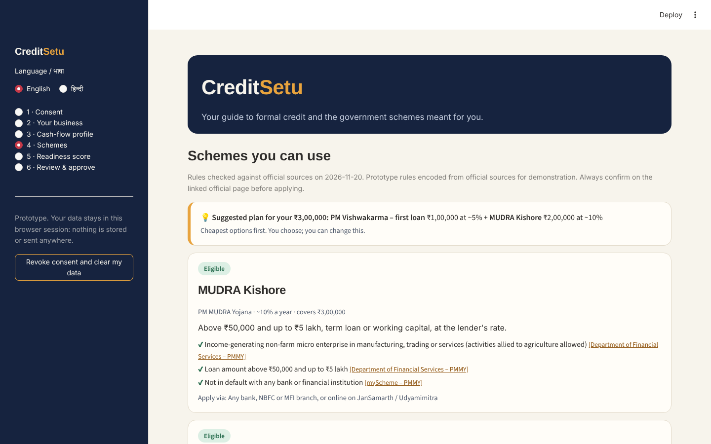
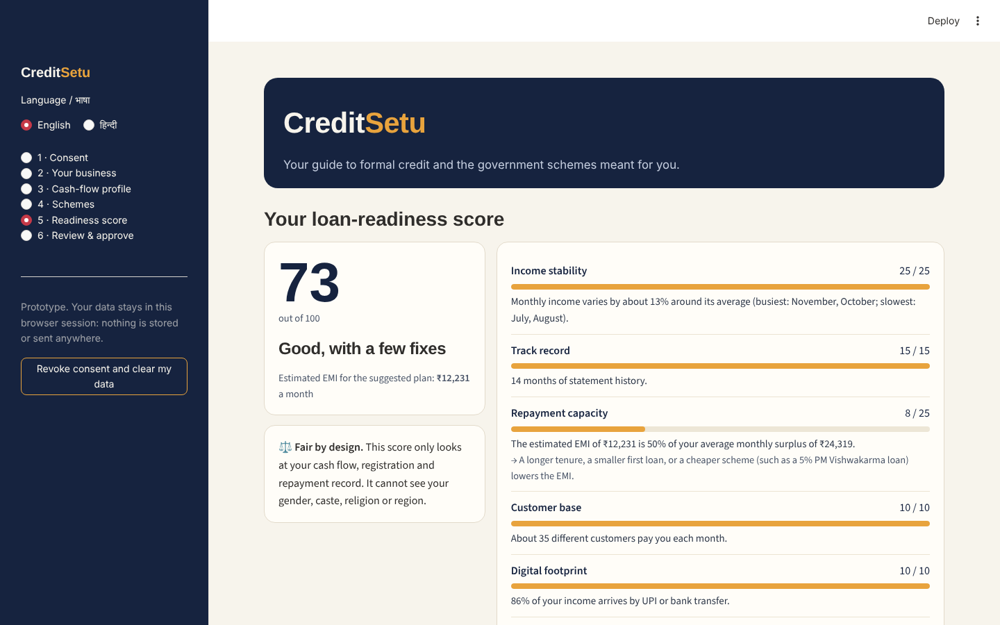
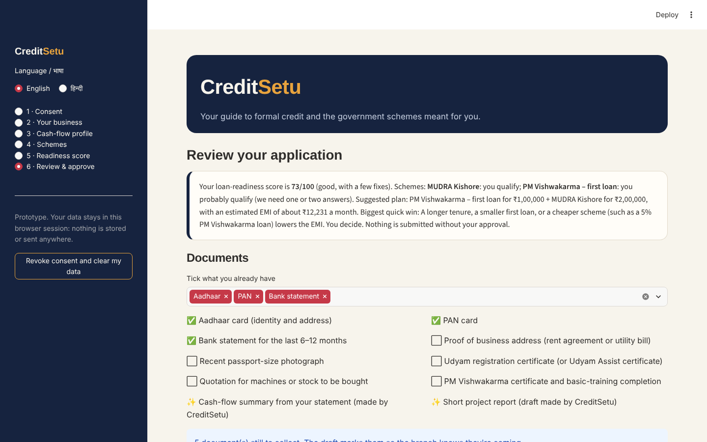
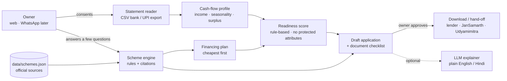

<div align="center">

# 🌉 CreditSetu

### An AI agent that connects small businesses to formal credit and the government schemes meant for them

*Setu* (सेतु) means **bridge**.


**Hackathon theme:** MSME Finance and Compliance · **Problem 3.2:** Viable small businesses cannot reach formal credit or the schemes meant for them

[The problem](#-the-problem) · [What it does](#-what-creditsetu-does) · [Demo](#-demo) · [How it works](#-how-it-works) · [Run it](#-run-it-locally) · [Responsible AI](#-responsible-ai-by-design) · [Research](research/) · [Roadmap](#-roadmap)

</div>

---

## 🧩 The problem

India's small businesses (tailors, fabricators, dairy units, SHG enterprises) often have **steady income visible in their UPI flows**, but not the ITRs or audited accounts banks ask for.

| | |
|---|---|
| **70–80%** | of the schemes they qualify for are missed |
| **15–20** | documents and months of follow-up per loan |
| **10–15%** | of the loan taken by middlemen |
| **24–36%** | interest charged by moneylenders when formal credit fails |

*Source: hackathon problem statement 3.2.* SIDBI estimates the MSME sector's addressable credit gap at **about ₹30 lakh crore**, and the gap is widest for women-owned businesses. More in [research/01-problem-analysis.md](research/01-problem-analysis.md).

## 💡 What CreditSetu does

CreditSetu is a **borrower-side agent**. It sits on the owner's side, not the lender's, and takes them from *"I need money"* to *"application ready"* in one guided flow:

| Step | What happens |
|---|---|
| **1. Consent first** | The owner sees exactly what data is used and why. Nothing is read until they agree. |
| **2. Read the signals** | A bank or UPI statement becomes a cash-flow profile: income, seasonality, surplus, customer base. |
| **3. Match schemes, with citations** | MUDRA, PM Vishwakarma, PMEGP, Stand-Up India, CGFMU and CGTMSE are checked against encoded rules. **Every criterion links to its official source.** |
| **4. Explain the score** | A transparent 0–100 readiness score. Every factor shows what was measured and how to improve it. |
| **5. Fill the file** | A checklist of only the missing documents, and a pre-filled application with a cash-flow summary. |
| **6. Owner approves** | Nothing leaves without the owner's explicit approval. |

**Example (the demo persona):** Sunita runs a tailoring unit and needs ₹3 lakh. CreditSetu finds that she fits **MUDRA Kishore**, and that as a tailor she's also likely eligible for **PM Vishwakarma**, a collateral-free loan at **5%** that most people in her position have never heard of. It explains why **Stand-Up India** and **PMEGP** are *not* a fit, and suggests a plan using the cheapest options first.

## 🎬 Demo

| Cash-flow profile | Schemes, each with its source |
|---|---|
|  |  |
| **Explainable readiness score** | **Review and approve** |
|  |  |

> The demo runs on a **synthetic** 14-month statement ([`data/sample_statement_sunita.csv`](data/sample_statement_sunita.csv)). No real person's data is used.

## ⚙️ How it works



**Key design choice:** the LLM is **never the source of truth**. Eligibility comes from deterministic rules with citations, and the score from transparent rules. An optional LLM layer only rephrases those results in simple English or Hindi, and is told to add nothing new. See [research/05-design-decisions.md](research/05-design-decisions.md).

## 🚀 Run it locally

```bash
git clone https://github.com/sreerevanth/CreditSetu.git
cd CreditSetu
python -m venv .venv && source .venv/bin/activate   # Windows: .venv\Scripts\activate
pip install -r requirements.txt
streamlit run app.py
```

Open http://localhost:8501, tick the two consent boxes, then click **"Fill in the demo: Sunita's tailoring unit"**.

To try your own data, upload a CSV statement. Both layouts work:
- `date, description, amount, type (CR/DR), mode, counterparty, balance`
- a typical bank export: `Date, Narration, Withdrawal Amt., Deposit Amt., Closing Balance`

**Optional AI explanations:** `pip install anthropic` and set `ANTHROPIC_API_KEY`. The consent screen then offers plain-language summaries. Only results are sent, never the statement.

**Run the tests:**

```bash
pytest -q
```

## 🛡️ Responsible AI by design

The brief sets four hard constraints. Here's how each one is met, and tested:

| Constraint | How CreditSetu meets it | Where |
|---|---|---|
| **Every eligibility claim cites its source** | Each criterion in `data/schemes.json` carries an official source URL. A test fails if any result lacks one. Unknown facts give **"needs info"**, never a guess. | [`creditsetu/schemes.py`](creditsetu/schemes.py), [`tests/test_engine.py`](tests/test_engine.py) |
| **Risk assessment is fair and explainable** | The score function **can't see** gender, caste, religion or region: they aren't parameters. A test runs every combination and checks that the score never changes. Each factor shows what it measured and how to improve. | [`creditsetu/score.py`](creditsetu/score.py), [`tests/test_fairness.py`](tests/test_fairness.py) |
| **Financial data only with consent** | Consent screen first; everything stays in the session; "Revoke consent" wipes it. Production would use the Account Aggregator framework. | [`app.py`](app.py) |
| **The owner approves every application** | Downloads stay locked until the owner ticks the approval box. Submission is simulated. | [`app.py`](app.py) |

**Honest limits:** score weights are judgement-based and **not yet calibrated** on repayment data (the app says so). Scheme rules were checked in November 2026 and must be kept current; PMEGP's continuation after March 2026 is flagged as *verify*.

## 🗂️ Project structure

```
CreditSetu/
├── app.py                      # Streamlit app: the six-step guided flow
├── creditsetu/
│   ├── statement.py            # Reads bank / UPI CSV statements
│   ├── profile.py              # Cash-flow profile: income, seasonality, surplus
│   ├── schemes.py              # Rule engine with citations + financing plan
│   ├── score.py                # Explainable readiness score + EMI maths
│   ├── application.py          # Draft application, checklist, JSON loan file
│   ├── explain.py              # Plain-language summary (template or optional LLM)
│   └── models.py               # Data structures
├── data/
│   ├── schemes.json            # Scheme rules with official sources
│   └── sample_statement_sunita.csv   # Synthetic demo statement
├── scripts/make_sample_data.py # Regenerates the synthetic statement
├── tests/                      # Engine, fairness and app smoke tests
├── research/                   # Problem analysis, scheme rules, landscape, design decisions
└── docs/screenshots/
```

## 📚 Schemes covered

| Scheme | What it offers | Sunita's result |
|---|---|---|
| **PM Vishwakarma** | Collateral-free loan up to ₹1 lakh at 5% (then ₹2 lakh) for 18 traditional trades | Likely eligible: needs training status |
| **MUDRA** (Shishu / Kishore / Tarun / Tarun Plus) | Collateral-free loans up to ₹20 lakh for non-farm micro units | **Eligible:** Kishore |
| **CGFMU** | Guarantee behind MUDRA loans | Applies with MUDRA |
| **CGTMSE** | Guarantee for collateral-free MSE loans up to ₹10 crore | Eligible, via lender |
| **PMEGP** | 15–35% subsidy for **new** units | Not a fit: existing unit |
| **Stand-Up India** | ₹10 lakh–₹1 crore for SC/ST and women, **greenfield** | Not a fit: amount and existing unit |

Full rules and sources: [research/02-scheme-rules.md](research/02-scheme-rules.md).

## 🛣️ Roadmap

- [x] **Hackathon prototype:** consent, statement parsing, cited scheme matching, explainable score, fairness test, draft application, English/Hindi summary
- [ ] PDF statement parsing and invoice-photo OCR
- [ ] WhatsApp interface with voice input in Hindi and regional languages
- [ ] Retrieval over official guideline PDFs to keep rules in sync, with human review of every change
- [ ] **Field pilot:** one SHG federation and one bank branch; measure approval rate and time to sanction
- [ ] Account Aggregator consent flow; hand-off to JanSamarth / Udyamimitra
- [ ] Calibrate score weights on real repayment outcomes; monitor approval rates by gender and region
- [ ] Borrower-agent integration with OCEN / ULI-connected lenders

## 🔬 Research

The [`research/`](research/) folder has the background work: [problem analysis](research/01-problem-analysis.md), [scheme rules with sources](research/02-scheme-rules.md), [users and journey](research/03-users-and-journey.md), [landscape (JanSamarth, AA, ULI, OCEN)](research/04-landscape.md), [design decisions](research/05-design-decisions.md), a [field research guide](research/06-field-research-guide.md), and [all sources](research/sources.md).

## ⚠️ Disclaimer

CreditSetu is a hackathon prototype, not financial advice and not a lender. Scheme rules are simplified from official sources as of November 2026 and can change. Always confirm on the official scheme page or with your bank before applying.

---

<div align="center">

Built by **[Sreerevanth](https://github.com/sreerevanth)** for the MSME Finance and Compliance hackathon track.

</div>
