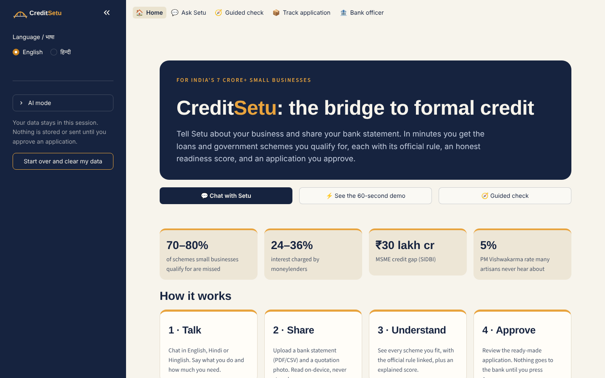
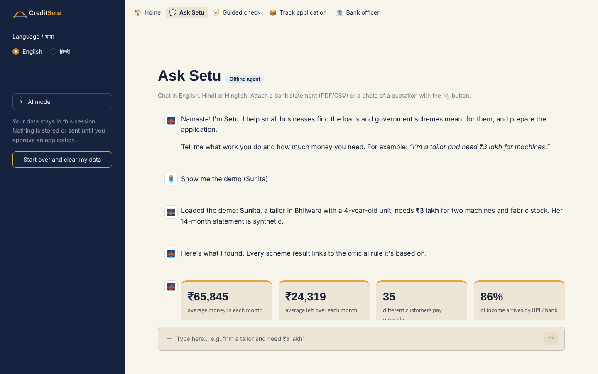
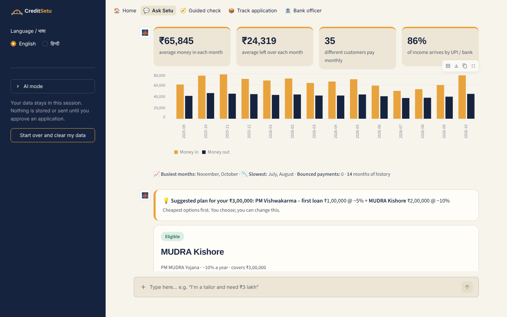
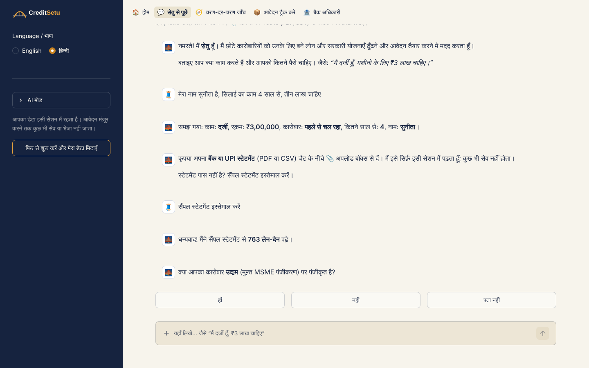
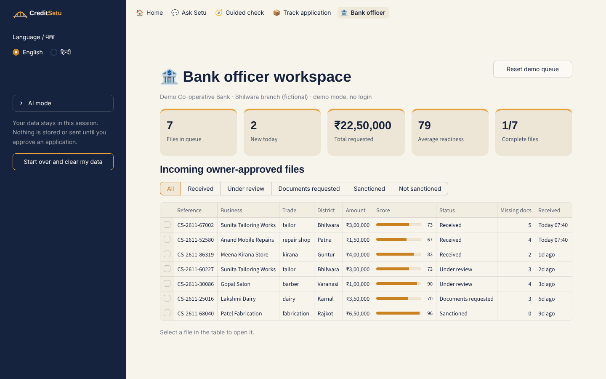
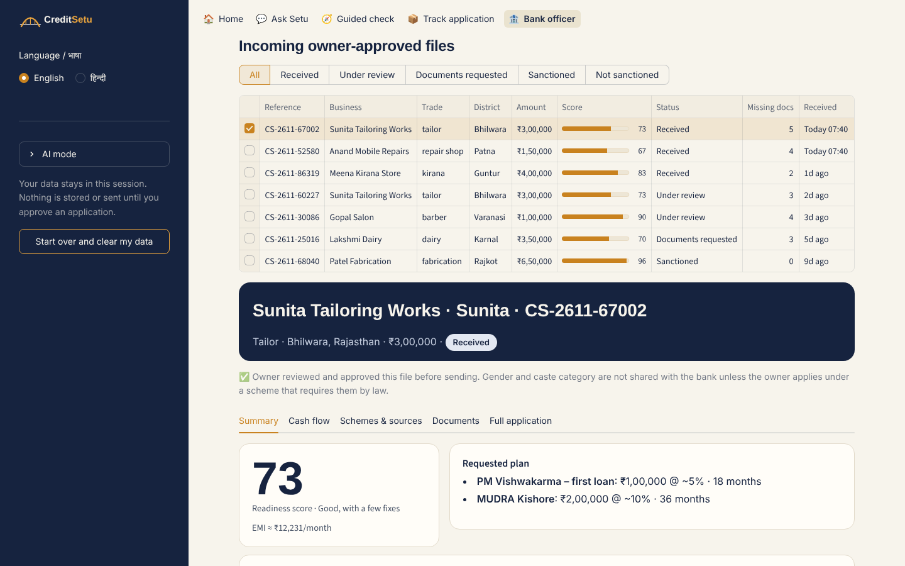
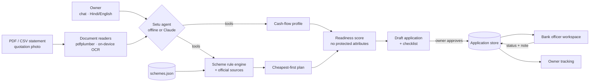

<div align="center">

# 🌉 CreditSetu

### The bridge between India's small businesses and the formal credit meant for them

*Setu* (सेतु) means **bridge**.


**Hackathon theme:** MSME Finance and Compliance · **Problem 3.2:** Viable small businesses cannot reach formal credit or the schemes meant for them

[What it does](#-what-creditsetu-does) · [Product tour](#-product-tour) · [How it works](#%EF%B8%8F-how-it-works) · [Run it](#-run-it) · [Deploy](DEPLOY.md) · [Responsible AI](#%EF%B8%8F-responsible-ai-by-design) · [Research](research/)

</div>

---

## 🧩 The problem

India's small businesses (tailors, fabricators, dairy units, SHG enterprises) often have **steady income visible in their UPI flows**, but not the ITRs or audited accounts banks ask for.

| | |
|---|---|
| **70–80%** | of the schemes they qualify for are missed |
| **15–20** | documents and months of follow-up per loan |
| **10–15%** | of the loan taken by middlemen |
| **24–36%** | interest charged by moneylenders when formal credit fails |

*Source: hackathon problem statement 3.2.* SIDBI puts the MSME sector's addressable credit gap at **about ₹30 lakh crore**, widest for women-owned businesses. More in [research/01-problem-analysis.md](research/01-problem-analysis.md).

## 💡 What CreditSetu does

CreditSetu is a **borrower-side agent** with a **lender-side workspace**. One product, both sides of the loan:

| For the business owner | For the bank |
|---|---|
| 💬 **Chat with Setu** in English, Hindi or Hinglish: *"मैं दर्जी हूँ, तीन लाख चाहिए"* | 🏦 **Officer workspace** with a queue of complete, owner-approved files |
| 📎 **Upload a PDF bank statement** or a **photo of a quotation**: read on the device, never stored | 📊 Cash-flow summary, readiness score with reasons, scheme fit with sources |
| 🔗 **Every scheme result cites its official rule**: MUDRA, PM Vishwakarma, PMEGP, Stand-Up India, CGFMU, CGTMSE | ✅ Document checklist: see at a glance what's missing |
| ⚖️ **Explainable readiness score** with concrete fixes ("register on Udyam: +10") | 🔁 One-click status updates and notes, **which the owner sees instantly** |
| ✍️ **Ready-made application** sent only when the owner presses **Approve** | 📥 Machine-readable JSON loan file for core banking systems |
| 📦 **Track the application** with a live timeline | |

**The "aha" in the demo:** Sunita, a tailor, asks for ₹3 lakh. Setu finds she fits **MUDRA Kishore**, and that as a tailor she's also likely eligible for **PM Vishwakarma**, a collateral-free loan at **5%** most artisans have never heard of. It explains why **Stand-Up India** and **PMEGP** are *not* a fit, plans the cheapest mix, drafts the file, and sends it to the bank once she approves.

## 🎬 Product tour

| Home | Chat with Setu |
|---|---|
|  |  |
| **Every scheme with its source** | **Full Hindi experience** |
|  |  |
| **Bank officer queue** | **Bank officer file view** |
|  |  |

> All demo data is **synthetic**: a 14-month statement for Sunita, a PDF version of it, a quotation photo, and six fictional businesses in the bank queue.

**Try it in 60 seconds:** open the app → **⚡ See the 60-second demo** → **Prepare my application** → tick the approval box → **Approve and send to bank** → open **🏦 Bank officer** to see it arrive → update its status → check **📦 Track application**.

## ⚙️ How it works



**The agent never decides eligibility.** Setu (offline or Claude) talks to the owner and calls tools, but eligibility comes only from the cited rule engine, the score only from the score function, and **submission is not a tool at all**: only the owner's *Approve* button can send a file.

### Two agent modes

| | Offline agent (default) | Claude agent (optional) |
|---|---|---|
| Needs | Nothing | An Anthropic API key (sidebar, env var or Streamlit secret) |
| Understands | English, Hindi, Hinglish: trades, amounts like *"dedh lakh"* / *"तीन लाख"*, yes/no, new vs running | Any phrasing |
| Tools | Same engine | Same engine, via tool use |
| If it fails | — | Falls back to the offline agent for that message, so the demo never breaks |

## 🚀 Run it

```bash
git clone https://github.com/sreerevanth/CreditSetu.git
cd CreditSetu
python -m venv .venv && source .venv/bin/activate   # Windows: .venv\Scripts\activate
pip install -r requirements.txt
streamlit run app.py
```

Open http://localhost:8501. Optional Claude mode: paste a key under **AI mode** in the sidebar, or `export ANTHROPIC_API_KEY=...`.

**Run the tests** (engine, fairness, agent conversations in both languages, Claude tool loop with a fake client, UI smoke tests):

```bash
pip install -r requirements-dev.txt
pytest -q
```

**Deploy a free public link:** see [DEPLOY.md](DEPLOY.md) (Streamlit Community Cloud in about 5 minutes; Docker and Hugging Face Spaces also covered).

## 🛡️ Responsible AI by design

| The brief's constraint | How CreditSetu meets it | Proof |
|---|---|---|
| **Every eligibility claim cites its source** | Each criterion in `data/schemes.json` carries an official URL; unknown facts give **"needs info"**, never a guess. The agent can only relay tool results. | [`schemes.py`](creditsetu/schemes.py), [`test_engine.py`](tests/test_engine.py) |
| **Fair, explainable risk assessment** | The score function **has no parameter** for gender, caste, religion or region. A test runs every combination and fails if the score moves. Each factor states what it measured and how to improve it. | [`score.py`](creditsetu/score.py), [`test_fairness.py`](tests/test_fairness.py) |
| **Financial data only with consent** | Statements and photos are processed in the session (OCR runs on the device). Nothing is stored until the owner approves. Gender/category are not shared with the bank. | [`documents.py`](creditsetu/documents.py), [`application.py`](creditsetu/application.py) |
| **The owner approves every application** | Submit exists only behind an approval checkbox and button, never as an agent tool. | [`ui/common.py`](ui/common.py), [`claude_agent.py`](creditsetu/agent/claude_agent.py) |

**Honest limits:** score weights are judgement-based and **not yet calibrated** on repayment data (the app says so). Scheme rules were checked in November 2026 and need upkeep; PMEGP's continuation after March 2026 is flagged *verify*. The bank workspace is a demo with no login.

## 🗂️ Project structure

```
CreditSetu/
├── app.py                     # Entry point: navigation, language, AI mode
├── ui/                        # Pages: home, chat, guided, track, officer + shared cards
├── creditsetu/
│   ├── agent/
│   │   ├── nlu.py             # English / Hindi / Hinglish understanding (amounts, trades, yes/no)
│   │   ├── offline.py         # Setu offline agent: dialogue, follow-ups, tool calls
│   │   └── claude_agent.py    # Optional Claude tool-use agent with offline fallback
│   ├── documents.py           # PDF statements, quotation-photo OCR
│   ├── statement.py           # CSV statements (simple + bank export formats)
│   ├── profile.py             # Cash-flow profile
│   ├── schemes.py             # Cited rule engine + cheapest-first plan (English & Hindi)
│   ├── score.py               # Explainable readiness score (English & Hindi)
│   ├── application.py         # Draft application, checklist, JSON loan file
│   ├── case.py                # One pipeline shared by chat, guided flow and seeding
│   ├── store.py               # SQLite application store + status events
│   ├── demo_seed.py           # Six fictional businesses for the bank queue
│   └── synthetic.py           # Synthetic statement generator
├── data/                      # schemes.json + synthetic statement (CSV/PDF) + quotation photo
├── tests/                     # 35 tests
├── research/                  # Problem, scheme rules, users, landscape, design decisions
├── DEPLOY.md · Dockerfile · packages.txt
└── docs/screenshots/
```

## 📚 Schemes covered

| Scheme | What it offers | Sunita's result |
|---|---|---|
| **PM Vishwakarma** | Collateral-free loan up to ₹1 lakh at 5% (then ₹2 lakh) for 18 traditional trades | Likely eligible: training to confirm |
| **MUDRA** (Shishu / Kishore / Tarun / Tarun Plus) | Collateral-free loans up to ₹20 lakh | **Eligible:** Kishore |
| **CGFMU** | Guarantee behind MUDRA loans | Applies with MUDRA |
| **CGTMSE** | Guarantee for collateral-free MSE loans up to ₹10 crore | Eligible, via lender |
| **PMEGP** | 15–35% subsidy for **new** units | Not a fit: existing unit |
| **Stand-Up India** | ₹10 lakh–₹1 crore for SC/ST and women, **greenfield** | Not a fit: amount and existing unit |

Full rules with sources: [research/02-scheme-rules.md](research/02-scheme-rules.md).

## 🛣️ Roadmap

- [x] Cited scheme engine, explainable score, fairness test
- [x] Chat agent (offline + Claude) in English and Hindi
- [x] PDF statements and quotation-photo OCR
- [x] Owner approval, bank officer workspace, live tracking
- [x] Deployable (Streamlit Cloud / Docker)
- [ ] WhatsApp channel with voice notes
- [ ] More languages (Marathi, Tamil, Telugu, Bengali)
- [ ] Account Aggregator consent flow instead of uploads; hand-off to JanSamarth / Udyamimitra
- [ ] **Field pilot** with one SHG federation and one bank branch; calibrate the score on repayment outcomes
- [ ] Bank SSO and Postgres for production

## 🔬 Research

[`research/`](research/) has the groundwork: [problem analysis](research/01-problem-analysis.md), [scheme rules with sources](research/02-scheme-rules.md), [users and journey](research/03-users-and-journey.md), [landscape (JanSamarth, AA, ULI, OCEN)](research/04-landscape.md), [design decisions](research/05-design-decisions.md), a [field research guide](research/06-field-research-guide.md), and [all sources](research/sources.md).

## ⚠️ Disclaimer

CreditSetu is a hackathon build, not financial advice and not a lender. Scheme rules are simplified from official sources as of November 2026 and can change; always confirm on the official scheme page or with your bank. All names, businesses, statements and documents in the demo are fictional.

---

<div align="center">

Built by **[Sreerevanth](https://github.com/sreerevanth)** for the MSME Finance and Compliance hackathon track.

</div>
